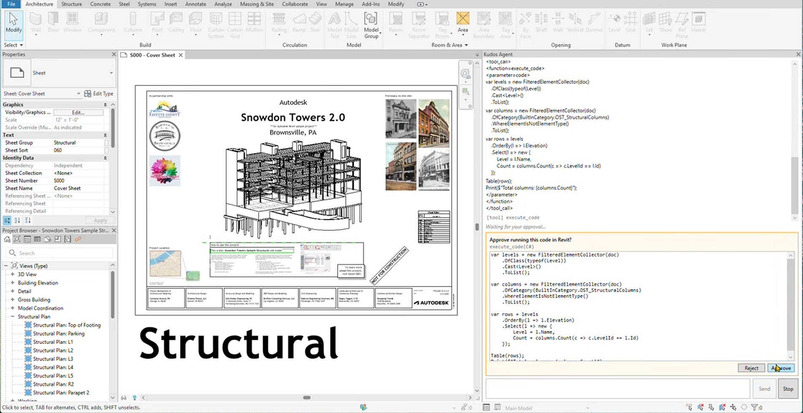

# Kudos Agent SDK v0.6.0

**An SDK for embedding an in-process AI coding agent into .NET applications**

[](https://www.youtube.com/watch?v=132ZBmiiJ1g)

**Demo video (YouTube):** https://www.youtube.com/watch?v=132ZBmiiJ1g — a local LLM writes Revit API C# code inside Revit, the user approves it, and the answer comes back as a table ([details](apps/revit/README.md))

[Overview](#overview) · [Packages](#packages) · [Getting the Packages](#getting-the-packages) · [Quick Start](#quick-start) · [Demo](#demo) · [Documentation](#documentation) · [License](#license) · [Author](#author)

---

## Overview

**Kudos Agent SDK** puts an AI coding agent inside your .NET application. The SDK provides the agent loop, built-in tools, skills, MCP, LLM backends and approvals. The model can run in your own process, so no sidecar server is needed.

The core use case: an instruction goes in, the agent writes and runs a script, and the result comes back as a table.

### Why Kudos Agent SDK?

- **In-process local models** — LLaMASharp (llama.cpp GGUF) runs inside the host process, with incremental KV-cache reuse across turns
- **Remote models (opt-in)** — Anthropic, OpenAI, Azure OpenAI, OpenAI-compatible, Amazon Bedrock and Google Gemini through each vendor's official SDK (`Microsoft.Extensions.AI` `IChatClient`)
- **Microsoft Agent Framework** — the agent loop runs on `Microsoft.Agents.AI`
- **Coding tools** — script execution, shell commands, file read / write / edit / patch, glob and grep search, a todo list, image viewing — or your own tools in place of them
- **Approvals** — a safety gate with approval policies, sandbox modes and exec rules; operations that need approval go to your approval handler, and are denied when there is none
- **Skills and MCP** — `SKILL.md` skills loaded on demand; MCP servers through the official C# SDK
- **Long tasks** — handoff context compaction, loop guards, session records with resume and fork, a hash-chained audit log
- **Images and PDFs** — attach files to a turn for models that accept them
- **Multi-agent** — sub-agents as tools, and parallel or sequential workflows

---

## Packages

The SDK ships as four NuGet packages (target `net10.0`):

| Package | Contents |
|---|---|
| [`Kudos.Agent.Sdk`](docs/packages/Kudos.Agent.Sdk.md) | Agent loop, built-in tools, safety gate and approvals, skills, MCP client, context compaction, loop guards, session records |
| [`Kudos.Agent.Sdk.LlamaSharp`](docs/packages/Kudos.Agent.Sdk.LlamaSharp.md) | In-process local models (LLaMASharp / llama.cpp GGUF) |
| [`Kudos.Agent.Sdk.Providers`](docs/packages/Kudos.Agent.Sdk.Providers.md) | Remote APIs — Anthropic, OpenAI, Azure OpenAI, OpenAI-compatible, Bedrock, Gemini |
| [`Kudos.Agent.Sdk.Workflows`](docs/packages/Kudos.Agent.Sdk.Workflows.md) | Multi-agent workflows — sessions in parallel (fan-out / fan-in) or in sequence |

---

## Getting the Packages

The packages are **not on nuget.org**, and they are not in this repository yet. They are provided to evaluation and commercial customers on request, together with a License Key and the reference command-line host (`Host.Cli`) that some documents use to store keys.

To evaluate the SDK, open an issue in this repository or contact the [author](#author). Once you have the `.nupkg` files, [docs/QUICK-START.md](docs/QUICK-START.md) shows how to reference them from a local folder feed.

**Requirements:** .NET SDK 10. Every session needs a License Key ([docs/LICENSING.md](docs/LICENSING.md)).

---

## Quick Start

```csharp
LlamaSharpChatClientProvider.Register();
var config = KudosAgentConfig.Load("kudos-agent.json");
using var client = await ChatClientFactory.CreateAsync(config.PrimaryModel);

await using var session = await new AgentSessionBuilder()
    .UseConfig(config)
    .UseChatClient(client)
    .UseApprovalHandler(op => Task.FromResult(false))   // deny everything that needs approval
    .BuildAsync();

await foreach (var evt in session.RunTurnEventsAsync("Count the lines of each file here as a Markdown table."))
    if (evt is AgentTextDelta text) Console.Write(text.Text);
```

See [docs/QUICK-START.md](docs/QUICK-START.md) for the complete example, [samples/](samples/README.md) for two runnable hosts and [json/](json/) for configuration examples.

---

## Demo

An application built on the SDK: an AI agent add-in **inside Autodesk Revit 2027**. A local LLM writes Revit API C# code, the user approves it, and the answer comes back as a table. See [apps/revit/README.md](apps/revit/README.md).

---

## Documentation

- **[docs/README.md](docs/README.md)** — SDK documentation index
- **[docs/QUICK-START.md](docs/QUICK-START.md)** — installation, requirements, a minimal config and host
- **[docs/EXAMPLES.md](docs/EXAMPLES.md)** — sample walkthroughs and focused snippets
- **[docs/API.md](docs/API.md)** — public API: `AgentSessionBuilder`, sessions, events, safety types, config loading
- **[docs/CONFIGURATION.md](docs/CONFIGURATION.md)** — the `kudos-agent.json` schema
- **[docs/MODELS.md](docs/MODELS.md)** — local and remote model backends
- **[docs/TOOLS.md](docs/TOOLS.md)** — built-in tools, your own tools, MCP
- **[docs/SAFETY.md](docs/SAFETY.md)** — approval policies, sandbox modes, the approval handler
- **[docs/SKILLS-GUIDE.md](docs/SKILLS-GUIDE.md)** — the `SKILL.md` format and discovery
- **[docs/SESSIONS.md](docs/SESSIONS.md)** — session records, resume and fork, compaction, loop guards
- **[docs/ATTACHMENTS.md](docs/ATTACHMENTS.md)** — images and PDFs
- **[docs/MULTI-AGENT.md](docs/MULTI-AGENT.md)** — sub-agents and workflows
- **[docs/SECRETS.md](docs/SECRETS.md)** — API keys and the OS secret store
- **[docs/LICENSING.md](docs/LICENSING.md)** — License Keys
- **[docs/ARCHITECTURE.md](docs/ARCHITECTURE.md)** — package split, components, extension points
- **[docs/TROUBLESHOOTING.md](docs/TROUBLESHOOTING.md)** — common failures with cause and fix
- **[CHANGELOG.md](CHANGELOG.md)** — release notes per package version

---

## License

Kudos Agent SDK is distributed under the End User License Agreement ([LICENSE](LICENSE)):

- **Evaluation** — free for up to 30 days; prototypes allowed, not in production, not distributed
- **Commercial license** — every other use (embedding the SDK in your own applications, production, commercial products) requires a commercial license and License Key from the Licensor

The sample code under `samples/` may be viewed, copied and modified for use in your applications. Third-party notices: [THIRD-PARTY-NOTICES.txt](THIRD-PARTY-NOTICES.txt).

---

## Author

**Hand-crafted by [Akira Kudo](https://www.linkedin.com/in/akira-kudo-4b04163/) in Tokyo, Japan**

<p align="center">Copyright © 2026 Akira Kudo</p>
