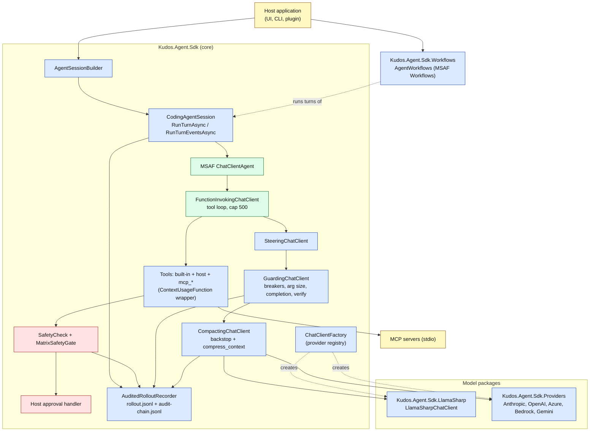

# Architecture

This page describes how the SDK is put together: which package does what, how one turn flows through the
components, where the important code lives, and where a host can plug in its own behaviour. For a first
working program see [QUICK-START.md](QUICK-START.md); for the public types see [API.md](API.md).

## Contents

1. [Packages and Dependencies](#packages-and-dependencies)
2. [Component Overview](#component-overview)
3. [One Turn, End to End](#one-turn-end-to-end)
4. [Extension Points](#extension-points)

---

## Packages and Dependencies

The SDK ships as four NuGet packages (version 0.6.0, each targeting `net10.0`). The split keeps
native runtimes, vendor SDKs and the workflow engine out of the core package: a host references only the packages it uses.

| Package | Contents | Direct dependencies |
|---|---|---|
| `Kudos.Agent.Sdk` | Agent loop and session, built-in tools, safety gate, skills, MCP client, prompts, rollout, guards, compaction, verify gate, audit chain, the Qwen-style prompt renderer and tool-call parser, and the model-provider registry (`ChatClientFactory`). Ships no model client. | `Microsoft.Agents.AI` 1.28.0, `ModelContextProtocol` 2.4.0 |
| `Kudos.Agent.Sdk.LlamaSharp` | In-process GGUF models: `LlamaSharpChatClient`, `StatefulLlamaExecutor` (incremental KV-cache reuse, one sequence per conversation with `seqMax` > 1, MTP speculative decoding with `mtp`), `LlamaSharpChatClientProvider` for `ModelType.LlamaCpp`. | `Kudos.Agent.Sdk`, `LLamaSharp` 0.30.0 |
| `Kudos.Agent.Sdk.Providers` | Remote model APIs through the vendors' official .NET SDKs: `RemoteChatClientProvider` for `Anthropic`, `OpenAI`, `AzureOpenAI`, `OpenAICompatible`, `Bedrock`, `Gemini`. | `Kudos.Agent.Sdk`, `Anthropic` 13.12.0, `AWSSDK.Extensions.Bedrock.MEAI` 4.0.101.8, `Google.GenAI` 2.2.0, `Microsoft.Extensions.AI.OpenAI` 10.11.1 |
| `Kudos.Agent.Sdk.Workflows` | Multi-agent workflows over sessions: `AgentWorkflows.Concurrent` (fan-out / fan-in) and `Sequential`, a workflow as an `AIAgent` for `AddSubAgent`. | `Kudos.Agent.Sdk`, `Microsoft.Agents.AI.Workflows` 1.28.0 |
| `Kudos.Agent.Sdk.A2A` (project, not packaged yet — `net10.0`) | A2A client (`A2AToolSource` → `a2a_<name>` tools) and server (`A2AServerHost` + `CodingAgentA2AHandler`) — [A2A.md](A2A.md). | `Kudos.Agent.Sdk`, `Microsoft.Agents.AI.A2A` / `Microsoft.Agents.AI.Hosting.A2A.AspNetCore` 1.28.0-preview.261106.1 (preview), ASP.NET Core shared framework |

Notes:

- `Kudos.Agent.Sdk.LlamaSharp` does **not** pull in a native backend. The application references exactly one
  of `LLamaSharp.Backend.Cpu`, `LLamaSharp.Backend.Cuda12` or `LLamaSharp.Backend.Cuda13` (version 0.30.0).
  See [MODELS.md](MODELS.md) and [TROUBLESHOOTING.md](TROUBLESHOOTING.md#the-native-library-cannot-be-correctly-loaded).
- `Host.Cli` in the repository is a reference host (batch mode and an interactive REPL). It is not packaged;
  read it as an example of wiring the SDK into a real program.
- The core package embeds the default prompts (`base-prompt.md` and the permission fragments), so a host
  needs no prompt files unless it wants to override them.

Blue: SDK code. Green: Microsoft Agent Framework (MSAF) / Microsoft.Extensions.AI. Yellow: host side.
Red: the approval path.

---

## Component Overview

### Agent loop and session

- **`AgentSessionBuilder`** is the one place a host assembles a session: config, session layout, skills index,
  system prompt, tool context (approval handler, host tools) and the model client. `BuildAsync()` returns a
  `CodingAgentSession`; `BuildInstructions(workDir)` returns the system prompt without creating a session.
- **`CodingAgentSession`** owns the MSAF `ChatClientAgent`, an `InMemoryChatHistoryProvider` and the rollout
  recorder. It runs turns in three shapes: `RunTurnAsync` (blocking, returns `AgentResponse`),
  `RunTurnStreamingAsync` (raw MSAF `AgentResponseUpdate`s) and `RunTurnEventsAsync` (typed `AgentEvent`s for a
  UI). It also exposes `Steering` (queue mid-turn input) and `RecordInterrupted(reason)`.
- **The client chain.** MSAF only lets the SDK see each model call through the `IChatClient` it calls, so all
  per-call behaviour is layered as `IChatClient` wrappers (outermost first):

  | Layer | Type | Job |
  |---|---|---|
  | 1 | `StreamingMessageBoundaryChatClient` | Gives streaming updates a role and message id so streamed history matches blocking history. |
  | 2 | `FunctionInvokingChatClient` (M.E.AI) | The tool loop, capped at `CodingAgentFactory.MaxToolLoopIterations` = 500 model round trips per turn. Wrapped *inside* MSAF so MSAF's own default cap of 40 is never reached. |
  | 3 | `SteeringChatClient` | Appends queued steer messages to the next model call (one shot). |
  | 4 | `GuardingChatClient` | Loop guards, argument-size guard, completion guard, verify gate. |
  | 5 | `CompactingChatClient` | Context compression (backstop and `compress_context`). |
  | 6 | your model client | `LlamaSharpChatClient`, a remote client, or any `IChatClient`. |

### Tools

Tools implement `ITool` (`Name` + an `AIFunction`). `ToolRegistry.CreateDefault` registers the built-in set:
`execute_code`, `bash_command`, `read_file`, `write_file`, `edit_file`, `apply_patch`, `glob_files`,
`grep_search`, `write_todos`, `read_todos`, `load_skill`, plus `compress_context` unless
`contextCompression.mode` is `backstop`. Host tools (`AddTool`) come after the defaults, then MCP tools
(`mcp_<server>_<tool>`). When compression is enabled every tool is wrapped in `ContextUsageFunction`, which
appends the current context size to string results. Tools report errors as results (a `{"ok": false, ...}`
envelope from `ToolResult.Fail`), never as exceptions. Details: [TOOLS.md](TOOLS.md).

### Safety gate

Every tool that reads, writes or executes calls `SafetyCheck.CheckAsync`, which asks the `ISafetyGate`
(default `MatrixSafetyGate`: approval policy x sandbox mode x exec rules, plus writable roots and argument
scope) for `Auto`, `Ask` or `Reject`. `Ask` goes to the host's approval handler; with no handler it is denied
(fail-closed). `execute_code` is always escalated to `Ask`. Each decision is recorded as a `safety-decision`
event, each answered prompt as `human-intervention`. Details: [SAFETY.md](SAFETY.md).

### Skills

`SkillLoader` scans the skills directory (`skills/<name>/SKILL.md` or `skills/<name>.md`), reads only the
frontmatter (`name`, `description`) and renders a short index into the system prompt. The model loads a
skill body on demand with `load_skill`. Malformed skills are skipped with a warning. Details:
[SKILLS-GUIDE.md](SKILLS-GUIDE.md).

### MCP

`McpClientManager` starts each enabled `mcpServers[]` entry as a stdio process (official `ModelContextProtocol`
SDK) before the agent is created, lists its tools and exposes them as `mcp_<server>_<tool>`. A server that
fails to start is skipped with a warning; an MCP tool error becomes a tool result. Under
`approvalPolicy: on-request` every MCP call asks for approval. Servers are stopped when the session is disposed.

### Prompts

`SystemPromptBuilder.Build` joins, with `"\n\n---\n\n"`: `base-prompt.md`, the sandbox-mode and approval-policy
fragments, every `AGENTS.md` found from the work directory up to the filesystem root, the skills index, and an
environment block (work directory, platform). The `compress_context` section of the base prompt gets the
context budget filled in, or is removed when compression is off or in `backstop` mode. The result is constant
for the session, which matters for the KV cache ([KV-CACHE.md](KV-CACHE.md)).

### Rollout, resume and fork

`RolloutRecorder` appends one JSON line per event to `<resultsRoot>/<sessionId>/rollout.jsonl` and keeps
`status.json` current. `RolloutResume` rebuilds the chat history from a rollout; `RolloutFork` copies a rollout
into a new session. See [SESSIONS.md](SESSIONS.md).

### Guards

`GuardingChatClient` runs on every model call: a persistent tool-call counter and optional budget
(`LoopGuardState`), four history-derived repeat breakers (`RepeatBreakers`), an argument-size guard and an
optional completion guard. At turn end `SingleWriterGuard` warns about files changed outside the agent's own
writes. Guard firings are `guard` events. See [SESSIONS.md](SESSIONS.md#loop-guards).

### Compaction

`ContextCompressionManager` estimates the size of the model's view before each call and, past the trigger
(or when the model called `compress_context`), replaces older history with a handoff summary plus the most
recent messages. `CompactingChatClient` keeps that compacted "shadow" view for the rest of the turn and the
session stores it at turn end. See [SESSIONS.md](SESSIONS.md#context-compression).

### Verify

`VerifyGate` runs when the model gives a final answer: it rejects an empty answer and, if it finds a test
command (`dotnet test`, `npm test`, `node --test`) in the verify directory, runs it and sends failures back to
the model up to `verify.maxAttempts` times. See [SESSIONS.md](SESSIONS.md#verify).

### Audit

`AuditedRolloutRecorder` (always on) mirrors every rollout line into `audit-chain.jsonl`, a SHA-256 hash chain
over the canonical (RFC 8785) JSON of each line. `AuditVerify.VerifySession(sessionDir)` checks it. Tampering is
detected, not prevented. See [SESSIONS.md](SESSIONS.md#audit-chain).

### LLM layer and provider registry

The core package defines `IChatClientProvider` and the static `ChatClientFactory` registry. The model packages
register their providers (`LlamaSharpChatClientProvider.Register()`, `RemoteChatClientProvider.Register()`);
`ChatClientFactory.CreateAsync(config.PrimaryModel)` then builds the client for `models[0]`. The agent only
ever sees `IChatClient`, so a host may skip the factory and pass any client to `UseChatClient`.

- **Local**: LLaMASharp has no tool-call API, so the SDK renders the Qwen chat template itself
  (`QwenPromptRenderer`, byte-identical with the Jinja template) and parses `<tool_call>` blocks from the output
  (`ToolCallParser`). `StatefulLlamaExecutor` keeps the KV cache alive across calls and decodes only new tokens
  when the prompt is an append-only extension ([KV-CACHE.md](KV-CACHE.md)). With `models[].config.seqMax` > 1
  the one context holds several sequences — one per slot of `subAgentPolicy.slots` — so a parent and its
  sub-agents keep separate caches, run in parallel, and have their generation steps decoded together.
- **Remote**: each vendor's official SDK behind `IChatClient`, wrapped with request rules (output-token cap,
  `effort` mapping, sanitising tool blocks the API would reject). Credentials come from environment
  variables, then the OS secret store (`Kudos.Agent.Secrets.SecretsLoader` — [SECRETS.md](SECRETS.md)). `ChatClientFactory.IsRemote`, `RemoteNotice` and `CredentialWarning` help a host tell the user
  where data goes and whether a key is missing. See [MODELS.md](MODELS.md).

### Multi-agent

- **Sub-agents** (core): `AddSubAgent` / `subAgents[]` / `spawn_agent` give a session `agent_*` tools. Each call runs
  one turn of a child `CodingAgentSession` (`SubAgentTool`) that shares the parent's work directory, sends its
  approvals to the parent's handler with `AgentPath`, cannot loosen the parent's safety, and records under
  `<session>/agents/<name>/`. Parallel calls share the tree's `maxConcurrent` budget; on llama-server each running
  agent is pinned to its own slot (`id_slot`).
- **Workflows** (`Kudos.Agent.Sdk.Workflows`): `AgentWorkflow` builds a Microsoft Agent Framework workflow per run
  (start → fan-out → participants → fan-in → join, or a chain) and runs one turn of each participant session.
- **Model sharing**: sessions on one in-process model take turns on it (`SerializedChatClient`, keyed by the client
  instance — `CodingAgentSession.ExclusiveModel`).

Guide: [MULTI-AGENT.md](MULTI-AGENT.md).

---

## One Turn, End to End

1. The host calls `session.RunTurnEventsAsync("...")` (or `RunTurnAsync`). The session records `user-input`,
   writes `status.json` = `running`, and snapshots the git worktree for the single-writer check.
2. MSAF appends the user message to the history and calls the client chain with the full message list, the
   system prompt (`ChatOptions.Instructions`) and the tool list.
3. `SteeringChatClient` appends any queued steer text. `GuardingChatClient` updates the tool-call counter and
   runs the repeat breakers; it may add a nudge message (to a copy of the list) or force a final answer.
4. `CompactingChatClient` estimates the context size; if compaction is due it asks the model for a handoff
   summary (a separate call straight to the model client) and swaps in the compacted view, recording a
   `compaction` event.
5. The model client generates a reply. For the in-process model only the new tail of the prompt is decoded when
   the history was extended append-only; otherwise the whole prompt is re-evaluated.
6. Back in `GuardingChatClient`: an oversized tool call is refused and the model re-invoked once; a final answer
   is checked by the completion guard and the verify gate.
7. If the reply contains tool calls, `FunctionInvokingChatClient` runs them. Each tool consults the safety gate
   (and the host's approval handler on `Ask`), executes, and returns a string result with the context-usage
   suffix. The loop goes back to step 3, up to 500 round trips.
8. When the model answers without tool calls the loop ends. The session replays the turn's new messages as
   `model-item` / `tool-call` / `tool-result` events, runs the single-writer check, records `turn-complete`,
   stores the compacted history if a compaction happened, and writes `status.json` = `complete`.
9. `RunTurnEventsAsync` yields `AgentTurnCompleted(finalText)` (or `AgentTurnFailed` / `AgentTurnCancelled`).

---

## Extension Points

| Need | Hook |
|---|---|
| Add a product-specific tool | `AgentSessionBuilder.AddTool(ctx => new MyTool(ctx))` or `AddTools(...)`. Call `SafetyCheck.CheckAsync(ctx, ...)` inside the tool to go through the gate. |
| Replace a built-in tool | `RemoveTool("execute_code")`, then `AddTool(...)` with the same name (a duplicate name throws `Duplicate tool name: '<name>'`). |
| Ask the user before risky operations | `UseApprovalHandler(Func<SafetyOperation, Task<bool>>)`. `SafetyOperation.Detail` carries display-only text such as the full script. |
| Custom policy | `ConfigureToolContext(ctx => ctx.SafetyGate = myGate)` with your own `ISafetyGate`. |
| Other tool environment settings | `ConfigureToolContext`: `Shell` (`ShellSpec`), `TodoStore` (`ITodoStore`), output and timeout limits, `ExcludeDirs`. |
| A new model backend | Implement `IChatClientProvider` and call `ChatClientFactory.Register(provider)`, or pass any `IChatClient` to `UseChatClient`. |
| Prompts | `UsePromptsDirectory(dir)` with your own `base-prompt.md` and `permissions/` fragments. |
| Skills | `UseSkillsDirectory(root)`, or `UseSkillsIndex(text)` with an index loaded once via `AgentSessionBuilder.LoadSkillsIndex`. |
| Session storage | `UseResultsDirectory(root, sessionId)` or `UseSessionLayout(layout)`. |
| Resume | `ResumeFrom(rolloutPathOrSessionDirectory)`. |
| Verification command location | `UseVerifyDirectory(repoRoot)`. |
| UI updates | `RunTurnEventsAsync` events, or subscribe to `session.Recorder.Recorded` for every rollout event (handlers run on the recording thread and must not block). |
| Mid-turn user input | `session.Steering.Enqueue(text)`. |
| Diagnostics | `UseLogger(ILogger)` receives MCP, skills, compaction and single-writer warnings. Without it they are dropped. |

---

## See Also

- [API.md](API.md) — the public types named on this page
- [SESSIONS.md](SESSIONS.md) — session records, compaction, loop guards, verify, audit
- [TOOLS.md](TOOLS.md) — the tool registry and MCP
- [MODELS.md](MODELS.md) — model clients and provider registration
- [KV-CACHE.md](KV-CACHE.md) — incremental KV-cache reuse for the in-process model
