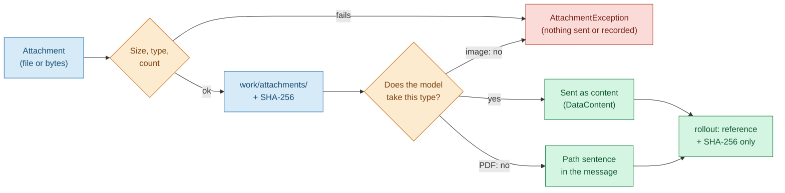

# Attachments — Images and PDFs

> Give the agent images and PDFs: attach them to a turn, let the model look at an image in the work directory with `view_image`, or return images from your own tools.

## Contents

1. [Overview](#overview)
2. [Attaching Files to a Turn](#attaching-files-to-a-turn)
3. [Which Models Take Images and PDFs](#which-models-take-images-and-pdfs)
4. [`view_image`](#view_image)
5. [Images from Your Own Tools](#images-from-your-own-tools)
6. [OpenAI-Format Tool Results](#openai-format-tool-results)
7. [Records, Verification and Resume](#records-verification-and-resume)
8. [Context Size and Compaction](#context-size-and-compaction)
9. [Limits](#limits)

---

## Overview

| Entry point | What it does |
|---|---|
| `CodingAgentSession.RunTurnAsync(text, attachments)` (and the streaming / event overloads) | Attaches images or PDFs to the user message of a turn. |
| `view_image` tool | The model looks at an image file in the work directory, for example a chart a script produced. Offered only to a model that takes images. |
| Host tools returning `DataContent` | A tool of yours returns an image (for example a captured view). |

Supported types: **PNG, JPEG, WebP, GIF and PDF**. Audio and video are not supported. The type is detected from the file's leading bytes (magic number), never from its extension, so a renamed file is rejected.



---

## Attaching Files to a Turn

```csharp
await using var session = await new AgentSessionBuilder()
    .UseConfig(config)
    .UseChatClient(client)
    .BuildAsync();

var drawing = session.Attachments.ImportFile("/data/drawing.png");        // checked + saved under work/attachments/
var spec    = session.Attachments.ImportBytes(pdfBytes, "spec.pdf");      // from memory

var response = await session.RunTurnAsync("Which parts in the drawing are missing from the spec?", [drawing, spec]);
```

`session.Attachments` (an `AttachmentStore`) checks each file before it writes anything and throws `AttachmentException`:

| Check | Limit / message |
|---|---|
| Size | `attachments.maxFileMb` (default 20 MB): `attachment '<name>' is too large: … (limit attachments.maxFileMb = 20 MB)`; an empty file is refused too |
| Type | PNG / JPEG / WebP / GIF / PDF by content: `unsupported attachment '<name>': the content is not PNG / JPEG / WebP / GIF / PDF (checked by content, not by extension)` |
| Missing file | `attachment not found: <path>` |

The file is saved as `<work directory>/attachments/<name>`, so the agent can open it with its tools too (`view_image`, `read_file`, `execute_code`). The same content under the same name is reused; a name already taken by other content gets the first 8 hex digits of its SHA-256 appended (`plot-1a2b3c4d.png`).

When the turn starts, the attachments are checked against the limit and the model, **before anything is recorded or sent**:

| Case | What happens |
|---|---|
| More than `attachments.maxPerMessage` (default 8) | `AttachmentException: too many attachments: <n> (limit attachments.maxPerMessage = 8)` |
| An image, and the model takes images | Sent as an image part of the user message |
| An image, and the model does not take images | `AttachmentException: the model '<id>' cannot take images ('<name>') — <fix>`, where `<fix>` depends on the model type: `LlamaCpp` → `set models[].config.mmproj to the model's image projector (mmproj-*.gguf) if it has one`; `OpenAICompatible` → `if the server runs with a vision projector (llama-server --mmproj), set models[].config.inputModalities to include "image"`; others → `set models[].config.inputModalities to include "image" if it can` |
| A PDF, and the model takes PDFs | Sent as a document part of the user message |
| A PDF, and the model does not take PDFs | **Not sent.** The message gets a sentence instead: `[attached PDF: attachments/spec.pdf (spec.pdf) — this model cannot read PDFs directly; extract the text with a tool if you need it]`. The agent can extract the text with `execute_code` / `bash_command` (for example `pdftotext`). |

`RunTurnAsync` throws the exception directly; `RunTurnStreamingAsync` and `RunTurnEventsAsync` throw it on the first enumeration step.

---

## Which Models Take Images and PDFs

`models[].config.inputModalities` declares what a model takes (`text`, `image`, `pdf`). Without it, the four remote vendors (`Anthropic`, `OpenAI` / `AzureOpenAI`, `Bedrock`, `Gemini`) take all three, `OpenAICompatible` takes text only, and `LlamaCpp` takes text — plus images when its projector is configured (`config.mmproj`). `session.InputModalities` returns the effective set.

```json
{ "id": "lan", "type": "OpenAICompatible",
  "config": { "serverUrl": "http://llm-host:8001/v1/", "inputModalities": ["text", "image"] } }
```

Declare `image` for an OpenAI-compatible server only when it really takes images (llama-server with `--mmproj`). For the in-process `LlamaCpp` model, set `config.mmproj` instead (declaring `image` without it is a configuration error). Per-provider details: [MODELS.md](MODELS.md#images-and-pdfs).

---

## `view_image`

The tool takes one parameter, `path` (relative to the work directory). It is registered only when the model takes images, so a text-only model's tool list does not change.

1. The path is checked like `read_file`: safety operation `read` (allowed automatically by the default gate) and the work-directory boundary.
2. The content is checked like an attachment: size limit, and an image by its leading bytes (a PDF or a text file returns `not an image`).
3. The image is copied to `attachments/`, and the model gets the text `{"ok":true,"output":"out/chart.png (image/png, 640x480, 12,345 bytes) — saved as attachments/chart.png"}` followed by the image.

The session record refers to the copy, so overwriting the original file later does not change the record.

---

## Images from Your Own Tools

Return `DataContent` from a tool built with `ToolFunction.CreateWithContent` ([TOOLS.md](TOOLS.md#returning-images)). The result of every built-in and host tool (MCP tools excepted) then goes through the same step:

- each image / PDF is checked (size, type by content) and saved under `attachments/`; a rejected one becomes `[attachment rejected: <reason>]` in the text;
- the result becomes `[TextContent(text), DataContent…]`;
- a type the model does not take becomes a sentence pointing at the saved file: `[image: view.png 800x600 — attachments/view.png] (not shown — the model does not take this type)`.

A result without media is not changed.

---

## OpenAI-Format Tool Results

Anthropic, Bedrock and Gemini carry images inside the tool result. The OpenAI Chat Completions format (`OpenAI`, `AzureOpenAI`, `OpenAICompatible`) cannot: a `role: tool` message holds text only. For these three types the request is rewritten before it is sent:

- the tool result keeps its text plus one line per image: `[image: chart.png 640x480 — attachments/chart.png] (shown in the next message)`;
- right after the tool messages of that step, one user message carries the images, each introduced by its call id: `Media returned by the tool calls above:` / `[call_1] [image: chart.png …]` / the image.

Only the request changes; the session history keeps the original tool result. The rewrite depends only on the history, so the same history always produces the same request (prompt caching keeps working), and earlier messages are not touched. The function is public as `AttachmentMessages.RelocateToolResultMedia` for hosts with their own OpenAI client.

---

## Records, Verification and Resume

- **Rollout.** `user-input` and `tool-result` events carry `attachments`: `path`, `mediaType`, `sha256`, `bytes`, `name`, `width` / `height` (images) and `referenceOnly` (a PDF whose path was sent instead of its content). The content itself is never written to `rollout.jsonl`. A turn without attachments is recorded exactly as before. See [SESSIONS.md](SESSIONS.md#event-types).
- **Audit chain.** The references, SHA-256 included, are part of the hashed event.
- **Verify.** `AuditVerify.VerifySession(sessionDir)` also checks each referenced file: a missing file or a SHA-256 mismatch is an issue with check `attachment`.
- **Resume.** The files are loaded back from the work directory. A file that is missing or changed becomes `[attachment missing: <name>]` in the message, and the logger gets a `[resume] …` warning. Keep the session's `work/attachments/` folder with its `rollout.jsonl` if you want to resume it.

---

## Context Size and Compaction

| Item | Counted as |
|---|---|
| An image | `contextCompression.imageTokens` (default 1,500) |
| A PDF sent as a document | estimated page count × `contextCompression.pdfPageTokens` (default 1,500) |

These numbers feed the compaction backstop, the context-usage line in tool results and the keep budget. During a compaction:

- the handoff summary request sees images and PDFs as their reference sentences (`[image: plot.png 640x480 — attachments/plot.png]`), not as content;
- when the kept messages exceed `keep.maxTokens`, the oldest kept messages' images become reference sentences first (the model can look again with `view_image`), before any text is cut.

---

## Limits

- No resizing: an image larger than `attachments.maxFileMb` is refused, and a model's own image-size limits apply to what is sent.
- The in-process `LlamaCpp` model takes images only with its projector (`models[].config.mmproj` — [MODELS.md](MODELS.md#images-and-pdfs)), and never PDFs directly.
- Audio and video are not supported.
- A2A file parts are not attached yet.
- Images and PDFs sent to a remote model leave the machine, like every other part of the prompt.

---

## See Also

- [CONFIGURATION.md](CONFIGURATION.md#11-attachments) — `attachments`, `inputModalities`, `imageTokens`, `pdfPageTokens`
- [MODELS.md](MODELS.md#images-and-pdfs) — what each provider receives
- [TOOLS.md](TOOLS.md) — `view_image`, returning images from a tool
- [SESSIONS.md](SESSIONS.md) — rollout events, resume, compaction, verify
- [API.md](API.md#kudosagentattachments) — the `Kudos.Agent.Attachments` types
