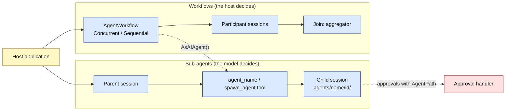

# Multi-Agent

The SDK can run several agents for one task in two ways:

| | Sub-agents | Workflows |
|---|---|---|
| Who decides | The parent's **model** calls a sub-agent as a tool (`agent_<name>`, `spawn_agent`) when it sees fit | The **host** runs a fixed plan: all participants at once (`AgentWorkflows.Concurrent`) or one after another (`AgentWorkflows.Sequential`) |
| Package | `Kudos.Agent.Sdk` | `Kudos.Agent.Sdk.Workflows` (adds `Microsoft.Agents.AI.Workflows` 1.28.0) |
| Each agent is | A child `CodingAgentSession` created by the SDK | A `CodingAgentSession` you build |
| Approvals | Go to the parent's approval handler, with `SafetyOperation.AgentPath` set | Go to each participant session's own handler |
| Records | `subagent-call` / `subagent-result` in the parent; the child's own rollout under `<parent session>/agents/<name>/` | `workflow-start` / `workflow-step` / `workflow-end` in the rollout you choose; each participant's turn in its own session |

The two combine: a workflow can be handed to a session as a sub-agent (`AgentWorkflow.AsAIAgent()` → `AddSubAgent(name, description, agent)`).



Blue: SDK. Yellow: host. Red: the approval path.

## Contents

1. [Sub-Agents](#sub-agents)
2. [Workflows](#workflows)
3. [Models and Parallelism](#models-and-parallelism)
4. [Records](#records)
5. [Limits at a Glance](#limits-at-a-glance)
6. [Sample](#sample)

---

## Sub-Agents

### Registering

```csharp
await using var session = await new AgentSessionBuilder()
    .UseConfig(config)
    .UseChatClient(chatClient)
    .UseApprovalHandler(approve)
    .AddSubAgent(
        "reviewer",
        "Reviews a change and lists concrete problems. Give it the file paths and what to check.",
        child => child.UsePromptsDirectory("prompts/reviewer").RemoveTool("execute_code"),
        new SubAgentOptions { Timeout = TimeSpan.FromMinutes(5) })
    .BuildAsync();
```

- The model sees a tool `agent_reviewer` with one argument, `query`. The description is the tool description: say when to use the sub-agent and what to give it, because the child does not see the parent's conversation.
- `configure` adjusts the child's builder: another model (`UseChatClient`), prompts, skills, or tools. The parent's own host tools are not inherited.
- The same sub-agents can come from `kudos-agent.json` (`subAgents[]` — [CONFIGURATION.md](CONFIGURATION.md#8-subagents)); config entries apply to the top-level session only.
- `AddSubAgent(name, description, AIAgent agent)` registers any Microsoft Agent Framework agent the same way, for example a workflow (see [Workflows as sub-agents](#workflows-as-sub-agents)).

### What the SDK enforces

| Rule | Effect |
|---|---|
| Work directory | The child works in the parent's work directory. |
| Approvals | The child's approval requests go to the parent's handler with `SafetyOperation.AgentPath` = the child's path (`reviewer`, nested `reviewer/checker`). A handler set inside `configure` is ignored. No parent handler = every `Ask` is refused. |
| Safety | The child's safety settings cannot be looser than the parent's: it may only narrow `sandboxMode`; other differences are ignored with a warning. |
| Depth | A session at depth `SubAgentPolicy.MaxDepth` (default 2; the top-level session is depth 0) gets no `agent_*` tools, so delegation stops there. |
| Result size | The child's answer is truncated to `MaxResultChars` (default 20000) with a `[truncated: N of M characters]` note. |
| Failures | A failure, a timeout or an empty answer comes back as a tool result `{"ok":false,"agent":…,"error":"failed|timeout|empty","message":…,"hint":…}`; the parent's turn continues. Cancelling the parent's turn cancels the child. |

### Dynamic sub-agents

With `subAgentPolicy.allowSpawn: true` (default off) the model also gets `spawn_agent(instructions, query)`: each call starts a one-shot child whose first message is the model-written instructions followed by the work. It uses the session's own model, prompts, skills and safety, and follows `MaxDepth`.

### Parallel sub-agents

When the model asks for several sub-agents in one response, up to `subAgentPolicy.maxConcurrent` (default 3) run at the same time; the rest wait. The session's other tools (file edits, commands, MCP calls) still run one at a time, and calls to the same `agent_<name>` with a kept conversation run one after another. Your approval handler may be called from several children at the same time — serialize your prompt if it is a console (see `samples/MultiAgentHost/Program.cs`).

---

## Workflows

```csharp
using Kudos.Agent.Workflows;

var review = AgentWorkflows.Concurrent(
    [
        new WorkflowParticipant("security", securitySession) { Instructions = "Look only for security problems." },
        new WorkflowParticipant("performance", performanceSession) { Instructions = "Look only for performance problems." },
    ],
    options: new AgentWorkflowOptions
    {
        Name = "review",
        Recorder = parentSession.Recorder,           // where workflow-* events go
        ParticipantTimeout = TimeSpan.FromMinutes(10),
        MaxFanOut = SubAgentPolicy.FromConfig(config.SubAgentPolicy).MaxFanOut,
    });

AgentWorkflowResult result = await review.RunAsync("Review the change in src/Orders.cs");
```

| Workflow | Behaviour |
|---|---|
| `Concurrent` | Every participant gets the same input (plus its own `Instructions`, if any) and runs at the same time. When all have reported, the aggregator combines the results — the default gives one `## <name>` section per participant. At most `MaxFanOut` participants (default 4). |
| `Sequential` | The first participant gets the input; each next one gets the input followed by `## Result of the previous step (<name>)` and that answer. The output is the last answer. |

- **Roles.** `WorkflowParticipant.Instructions` gives a participant its part of the task: its input becomes `## Your instructions` + the instructions, then `## Task` + the workflow input.
- **Nobody is waited for forever.** A participant that fails, times out (`ParticipantTimeout`) or answers nothing still reports a `ParticipantResult` with that status. A concurrent run is `ok` when everyone answered, `partial` when some did not, and `failed` when nobody did or the aggregator threw. A sequential run stops at the first step that did not answer and lists the rest in `Missing`.
- **One run at a time per workflow** (a session runs one turn at a time). Each run is a fresh Microsoft Agent Framework workflow. A failed run is not resumed — run it again.
- **Cancellation** ends every participant's turn (each records `turn-interrupted`), records `workflow-end` with status `cancelled`, and throws `OperationCanceledException`.
- **Approvals** come from each participant session's own handler. Give the participants the same handler if one person approves everything.
- **Other graphs.** For switches, custom fan-out or nested workflows, use the Microsoft Agent Framework `WorkflowBuilder` directly with `CodingAgentSessionAgent` participants. Handoff orchestration is not supported: it injects tools into each run, while a session's tool list is fixed when it is built.

### Workflows as sub-agents

```csharp
var parent = await new AgentSessionBuilder()
    .UseConfig(config)
    .UseChatClient(chatClient)
    .AddSubAgent("review", "Runs the security and performance reviewers on a change.", review.AsAIAgent())
    .BuildAsync();
```

The parent's model calls `agent_review`; each call is one workflow run on the call's `query`, and the answer is the workflow's output (a `failed` run becomes the usual error result). The call is recorded as a sub-agent call with the agent's id as `childSessionId`. The participants are not child sessions of the parent: they keep their own approval handlers, safety settings and records.

---

## Models and Parallelism

Whether agents really run at the same time depends on the model behind them.

| Model | Parallel? | Notes |
|---|---|---|
| Remote APIs (`Anthropic`, `OpenAI`, …) | Yes | Each agent's request is independent. Calls are billed per agent. |
| llama-server (`OpenAICompatible`) | Yes, one slot per running agent | With sub-agents the top-level session uses slot `subAgentPolicy.slots.parent` (default 1) and each running sub-agent one of `slots.subAgents` (default 2, 3, 4); start the server with `--parallel` greater than the largest slot. With `--kv-unified` all slots share one KV pool of `--ctx-size` tokens. Workflow participants are not pinned; the server picks idle slots. See [CONFIGURATION.md](CONFIGURATION.md#9-subagentpolicy). |
| In-process `LlamaCpp`, `seqMax` 1 (default) | **No** | One model serves one request at a time. Every session on the same client — parent, sub-agents, workflow participants — waits for the model's gate (`CodingAgentSession.ExclusiveModel` names the shared instance; a concurrent workflow logs a warning and records `serialized: true`). |
| In-process `LlamaCpp`, `seqMax` > 1 | Yes, one sequence per slot | The same slots as llama-server (`subAgentPolicy.slots` — parent 1, sub-agents 2, 3, 4 by default; `seqMax` must be greater than the largest slot, `5` for the defaults). Each sequence keeps its own KV cache, so the parent resumes after a sub-agent call with only the new tokens. Agents generating at the same time share each model step: their next tokens are decoded together in one batch, so the total generation speed rises with the number of running agents (about 1.5× for two on a laptop CPU). With `kvUnified` `true` (the default) agents running at the same time also slow each other's steps down on a large model — see `kvUnified` in [CONFIGURATION.md](CONFIGURATION.md#3-models); the prompt of each conversation is still processed one at a time. Workflow participants run in parallel when they use different `slots.parent` values; participants on the same slot take turns (`ExclusiveModel` is the model and the slot). See [CONFIGURATION.md](CONFIGURATION.md#9-subagentpolicy). |

**Switch cost on the in-process model with `seqMax` 1.** The in-process client then keeps the KV cache of one conversation only (see [KV-CACHE.md](KV-CACHE.md)). Each time the model switches to another agent's conversation, that conversation's whole prompt is processed again; after a sub-agent call the parent's whole prompt is processed again. The cost grows with the prompt: in one measurement (a small model on a laptop CPU) a 6,000-token parent prompt took about 42 s after a sub-agent call, instead of about 0.5 s for an unchanged conversation.

Recommended set-ups:

- Parent on a large local model, sub-agents on a **small local model** (another `LlamaCpp` entry — its own client) or a **remote model** (`subAgents[].modelId`).
- Fan-out workflows on remote models or llama-server.
- With one in-process model only, set `models[].config.seqMax` to `5` (memory: one recurrent state per sequence — about 150 MiB each for a 27B hybrid model), or prefer few, substantial sub-agent calls over many small ones.

---

## Records

```text
results/<parent session>/
  rollout.jsonl                       subagent-call / subagent-result (and workflow-* when this session is the Recorder)
  agents/<name>/<child session>/      the child's rollout.jsonl, status.json, audit-chain.jsonl
```

- `subagent-result.childAuditHead` is the head hash of the child's audit chain after the call, linking the parent's chain to the child's.
- Workflow participants are separate sessions: their directories are wherever their builders put them; `workflow-step.sessionId` names each one.
- Event fields: [SESSIONS.md](SESSIONS.md#event-types).

---

## Limits at a Glance

| Setting | Default | Where |
|---|---|---|
| Nesting depth | 2 | `subAgentPolicy.maxDepth` / `SubAgentPolicy.MaxDepth` |
| Answer size returned to the parent | 20000 characters | `subAgentPolicy.maxResultChars` |
| Sub-agents running at once | 3 | `subAgentPolicy.maxConcurrent` |
| Participants of one concurrent workflow | 4 | `subAgentPolicy.maxFanOut` → `AgentWorkflowOptions.MaxFanOut` |
| One sub-agent call | none | `SubAgentOptions.Timeout`, `subAgents[].timeoutSeconds`, `subAgentPolicy.spawnTimeoutSeconds` |
| One participant's turn | none | `AgentWorkflowOptions.ParticipantTimeout` |

---

## Sample

[`samples/MultiAgentHost`](../samples/MultiAgentHost/) runs both patterns with a scripted model or a real one — walkthrough in [EXAMPLES.md](EXAMPLES.md#the-multi-agent-sample-samplesmultiagenthost).

---

## See Also

- [EXAMPLES.md](EXAMPLES.md#the-multi-agent-sample-samplesmultiagenthost) — the multi-agent sample
- [CONFIGURATION.md](CONFIGURATION.md#8-subagents) — `subAgents` and `subAgentPolicy`
- [A2A.md](A2A.md) — agents in other processes
- [SAFETY.md](SAFETY.md) — approvals for sub-agent tool calls
- [API.md](API.md#kudosagentworkflows) — the `Kudos.Agent.Workflows` types
- [Kudos.Agent.Sdk.Workflows](packages/Kudos.Agent.Sdk.Workflows.md) — package README
