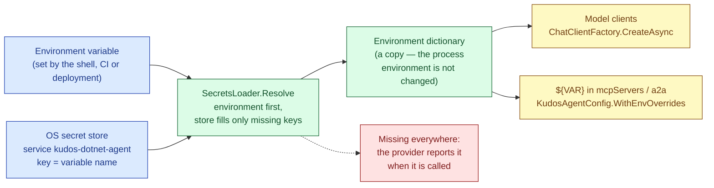

# Secrets: API Keys and Tokens

The SDK reads credentials (model API keys, tokens for MCP servers and A2A agents) from two places: **environment variables** and the **OS secret store**. Keys never go in `kudos-agent.json`, and the SDK does not load `.env` files.

- [Where keys come from](#where-keys-come-from)
- [Setting a key on each OS](#setting-a-key-on-each-os)
- [Storing a key](#storing-a-key)
- [Using the store from your host](#using-the-store-from-your-host)
- [MCP servers and A2A agents](#mcp-servers-and-a2a-agents)
- [Redaction in logs and session records](#redaction-in-logs-and-session-records)
- [Turning the store off](#turning-the-store-off)
- [Limits](#limits)

## Contents

1. [Where Keys Come From](#where-keys-come-from)
2. [Setting a Key on Each OS](#setting-a-key-on-each-os)
3. [Storing a Key](#storing-a-key)
4. [Using the Store from Your Host](#using-the-store-from-your-host)
5. [MCP Servers and A2A Agents](#mcp-servers-and-a2a-agents)
6. [Redaction in Logs and Session Records](#redaction-in-logs-and-session-records)
7. [Turning the Store Off](#turning-the-store-off)
8. [Limits](#limits)

---

## Where Keys Come From



1. **The environment wins.** If a variable is set (and not empty), that value is used and the store is not asked. A deployment or CI job that sets `ANTHROPIC_API_KEY` keeps working as before.
2. **The store fills the gaps.** For each needed key that is missing, the SDK looks in the OS secret store under the same name.
3. **Nothing is invented.** A key found in neither place stays missing. The model client throws its usual "… is not set" error when it is created (or the provider rejects the call), and `ChatClientFactory.CredentialWarning` still warns up front. Reading the store never throws: if the store can't be read (no store, CLI missing, timeout), the key counts as missing.

The SDK never writes the process environment. The resolved values live only in the dictionary the SDK hands to the model clients and to `WithEnvOverrides`.

### The OS stores

| OS | Store | Entry | Access |
|---|---|---|---|
| macOS | Keychain (login keychain) | generic password, account `kudos-dotnet-agent`, service = the key name | `security` CLI |
| Linux | libsecret (GNOME Keyring, KWallet via the Secret Service API) | attributes `service=kudos-dotnet-agent`, `key=<key name>` | `secret-tool` CLI (package `libsecret-tools`) |
| Windows | Credential Manager | generic credential, target `kudos-dotnet-agent/<key name>`, user `kudos-dotnet-agent` | advapi32 (`CredRead` / `CredWrite` / `CredDelete`) |

The key name is the environment variable name, for example `ANTHROPIC_API_KEY`. Key names may contain letters, digits, `_`, `-` and `.`.

### Which keys are looked up

| Model type | Keys |
|---|---|
| `Anthropic` | `ANTHROPIC_API_KEY`, `ANTHROPIC_AUTH_TOKEN` |
| `OpenAI`, `OpenAICompatible` | `OPENAI_API_KEY` |
| `AzureOpenAI` | `AZURE_OPENAI_API_KEY` |
| `Bedrock` | `AWS_ACCESS_KEY_ID`, `AWS_SECRET_ACCESS_KEY`, `AWS_SESSION_TOKEN` |
| `Gemini` | `GEMINI_API_KEY`, `GOOGLE_API_KEY` |
| `LlamaCpp` | none |

Settings that are not secrets (`AZURE_OPENAI_ENDPOINT`, `AWS_REGION`, `MODEL_ID`, …) are read from the environment only.

A key in the store is treated exactly like the environment variable of the same name. For example, an `OPENAI_API_KEY` in the store is also sent to an `OpenAICompatible` server, just as the environment variable would be (see [MODELS.md](MODELS.md#remote-providers)).

---

## Setting a Key on Each OS

Two ways, on every OS:

- **The OS secret store (recommended).** Register the key once per machine and user. It is kept encrypted by the OS, survives reboots and new shells, and is read only when a key is missing from the environment.
- **An environment variable.** Quick for one session or for CI. To make it permanent you have to write it into a shell profile or the user environment, where it is stored as plain text.

The examples use `GEMINI_API_KEY`. A Gemini key on the free tier works, but its quota (5 requests per minute and 20 per day for `gemini-3.6-flash`, measured 2026-11-25) is too small for agent runs, so enable billing on its project for real use. See [MODELS.md — Google Gemini](MODELS.md#google-gemini). Any key name from [Which keys are looked up](#which-keys-are-looked-up) works the same way. `Host.Cli` stands for the bundled CLI host. From a source checkout, use `dotnet run --project src/Host.Cli --` instead. If the shell says `dotnet: command not found`, the .NET SDK is installed per user (for example in `~/.dotnet`) and is not on `PATH`: run `export PATH="$HOME/.dotnet:$PATH" DOTNET_ROOT="$HOME/.dotnet"` first.

### macOS

Secret store (login keychain):

```bash
Host.Cli secrets set GEMINI_API_KEY      # paste the key at "value for GEMINI_API_KEY (input hidden):", then Enter
Host.Cli secrets list                    # GEMINI_API_KEY  store
```

Without the CLI host: `security add-generic-password -U -a kudos-dotnet-agent -s GEMINI_API_KEY -w` (prompts for the value).

Environment variable:

```bash
read -rs GEMINI_API_KEY && export GEMINI_API_KEY    # this shell only; the value is not echoed or kept in history
```

For every new shell, add `export GEMINI_API_KEY=...` to `~/.zprofile` (zsh, the default) or `~/.bash_profile` (bash). The file holds the key in plain text.

### Linux

Secret store (GNOME Keyring or KWallet through libsecret; needs `secret-tool`, package `libsecret-tools`):

```bash
Host.Cli secrets set GEMINI_API_KEY
Host.Cli secrets list
```

Without the CLI host: `secret-tool store --label='kudos-dotnet-agent GEMINI_API_KEY' service kudos-dotnet-agent key GEMINI_API_KEY` (prompts for the value).

Run it in a terminal of your **desktop session**. The keyring is unlocked when you log in to the desktop. In an SSH-only session it may be locked, and then the write fails and reads find nothing.

Environment variable:

```bash
read -rs GEMINI_API_KEY && export GEMINI_API_KEY    # this shell only
```

For every new shell, add `export GEMINI_API_KEY=...` to `~/.bashrc` or `~/.profile` (plain text). For a systemd service, use `Environment=` or `EnvironmentFile=` with a file readable only by the service user.

### Windows

Secret store (Credential Manager):

```powershell
Host.Cli secrets set GEMINI_API_KEY      # hidden prompt
Host.Cli secrets list
```

Without the CLI host: `cmdkey /generic:kudos-dotnet-agent/GEMINI_API_KEY /user:kudos-dotnet-agent /pass` (prompts for the value). The entry appears in Control Panel → Credential Manager → Windows Credentials as `kudos-dotnet-agent/GEMINI_API_KEY`.

Environment variable:

```powershell
$env:GEMINI_API_KEY = Read-Host -MaskInput 'GEMINI_API_KEY'     # this PowerShell session only (PowerShell 7.1+)
[Environment]::SetEnvironmentVariable('GEMINI_API_KEY', '<key>', 'User')   # permanent for the user; new terminals only
```

The user environment is stored in plain text in the registry. Programs that are already running, an IDE for example, do not see a variable you just set. Restart them.

### Check what you stored

`Host.Cli secrets list` shows only whether a key is set (`env`, `store`, `env (wins) + store`, `-`), never its value. A wrong value shows up as the provider's authentication error, for example Gemini's `API key not valid` (`API_KEY_INVALID`).

The hidden prompt shows nothing while you paste. **Make sure the clipboard holds the key.** In one measured case (2026-11-25), the next command line was pasted at the prompt instead of the key. The store then held a 102-character text with spaces, and Gemini answered `API_KEY_INVALID`. To compare the stored value's length with your key without printing it:

```bash
security find-generic-password -a kudos-dotnet-agent -s GEMINI_API_KEY -w | tr -d '\n' | wc -c     # macOS
secret-tool lookup service kudos-dotnet-agent key GEMINI_API_KEY | wc -c                          # Linux
```

Run `Host.Cli secrets set` again to replace a wrong value. Key formats differ between providers and key types (for example, not every Gemini key starts with `AIza`), so the SDK does not check the format.

---

## Storing a Key

### With the bundled CLI host

```bash
# the value is read from stdin (or typed at a hidden prompt) — never from the command line
printf '%s' 'sk-ant-...' | Host.Cli secrets set ANTHROPIC_API_KEY
Host.Cli secrets set OPENAI_API_KEY            # on a terminal: hidden prompt

Host.Cli secrets list                          # key names and where each is set — never values
Host.Cli secrets list --config json/kudos-agent.json   # + the config's ${VAR} references
Host.Cli secrets remove ANTHROPIC_API_KEY
```

`list` prints one line per key: `env`, `store`, `env (wins) + store` or `-`.

### With the OS tools

macOS (the value is typed at a prompt when `-w` is the last option):

```bash
security add-generic-password -U -a kudos-dotnet-agent -s ANTHROPIC_API_KEY -w
security delete-generic-password -a kudos-dotnet-agent -s ANTHROPIC_API_KEY
```

Linux (the value is read from stdin):

```bash
printf '%s' 'sk-ant-...' | secret-tool store --label='kudos-dotnet-agent ANTHROPIC_API_KEY' service kudos-dotnet-agent key ANTHROPIC_API_KEY
secret-tool clear service kudos-dotnet-agent key ANTHROPIC_API_KEY
```

Windows (`/pass` without a value prompts for it):

```powershell
cmdkey /generic:kudos-dotnet-agent/ANTHROPIC_API_KEY /user:kudos-dotnet-agent /pass
cmdkey /delete:kudos-dotnet-agent/ANTHROPIC_API_KEY
```

### From code

```csharp
using Kudos.Agent.Secrets;

SecretStores.Default.Set("ANTHROPIC_API_KEY", key);   // throws SecretStoreException on failure
string? value = SecretStores.Default.Get("ANTHROPIC_API_KEY");   // null when missing; never throws
bool removed = SecretStores.Default.Remove("ANTHROPIC_API_KEY");
```

---

## Using the Store from Your Host

**Nothing to do for model clients.** `ChatClientFactory.CreateAsync(model)` without an `environment` argument resolves the model's keys (environment first, then the store). Sub-agents that run their own model use the same path.

**For the config's `${VAR}` references and the credential warning**, resolve once after loading the config and pass the result on, as the bundled host does:

```csharp
using Kudos.Agent.Secrets;

var config = KudosAgentConfig.Load(path);
// the process environment + every key the config needs (model credentials, ${VAR} refs) filled from the store
var environment = SecretsLoader.ResolveProcessEnvironment(config);
config = config.WithEnvOverrides(environment);

foreach (var name in config.MissingEnvRefs)
    Console.Error.WriteLine($"WARNING: ${{{name}}} is not set");

var model = config.PrimaryModel;
if (ChatClientFactory.CredentialWarning(model, environment) is { } warning)
    Console.Error.WriteLine(warning);
var client = await ChatClientFactory.CreateAsync(model, environment: environment);
```

| API | Purpose |
|---|---|
| `SecretsLoader.Resolve(environment, keys, store?)` | A copy of `environment` with each of `keys` that is missing or empty filled from `store` (default `SecretStores.Default`). Never throws for a store failure. |
| `SecretsLoader.ResolveProcessEnvironment(config, store?)` | `Resolve(ChatClientFactory.ProcessEnvironment(), KeysFor(config), store)`. |
| `SecretsLoader.KeysFor(config)` | The credential keys of every `models[]` entry, then the config's `${VAR}` names. |
| `SecretsLoader.EnvRefs(config)` | The `${VAR}` names in `mcpServers[].env`, `a2a.agents[].headers` and `a2a.server.token`. |
| `SecretsLoader.CredentialKeys(type)` / `DefaultKeys` | The key table above, per model type / all of it. |
| `SecretStores.Default` | The store used when none is passed (settable). |
| `SecretStores.ForCurrentOs()` / `SecretStores.None` | The native store of this OS / a store that holds nothing. |
| `ISecretStore` | Implement it to use another store (a vault service, a test fake). |

An explicit `environment` dictionary is used as given — the factory does not consult the store for it. `ChatClientFactory.ProcessEnvironment()` is the plain process environment without the store.

---

## MCP Servers and A2A Agents

A `${VAR}` reference in `mcpServers[].env`, `a2a.agents[].headers` or `a2a.server.token` is how a config declares a secret that a server or agent needs:

```jsonc
"mcpServers": [
  { "name": "search", "command": "search-mcp", "env": { "SEARCH_API_KEY": "${SEARCH_API_KEY}" } }
]
```

Store the value once (`Host.Cli secrets set SEARCH_API_KEY`) and it is filled in when the host resolves the environment with `SecretsLoader.ResolveProcessEnvironment(config)` (or `KeysFor(config)`). A reference found nowhere is removed from the value (as before) and listed in `config.MissingEnvRefs`; the bundled host prints a warning for each one.

---

## Redaction in Logs and Session Records

`Kudos.Agent.Secrets.Redactor` replaces secrets with `[REDACTED]`:

- **Known key formats:** Anthropic `sk-ant-…`, OpenAI `sk-proj-…` / `sk-svcacct-…` / `sk-admin-…` / `sk-…`, Google `AIza…`, AWS access key ids `AKIA…` / `ASIA…`.
- **Resolved values:** every value `SecretsLoader.Resolve` returned for a requested key (from the environment or the store), in plain and JSON-escaped form. This covers keys without a recognizable format (Azure keys, AWS secret keys, MCP tokens). Values shorter than 8 characters are not registered.
- **Secret-named JSON properties:** in tool-call arguments, a property whose name ends in `api_key` / `apiKey` / `secret` / `password` / `token` / `credential(s)` / `authorization` is masked (`access_token` is, `max_tokens` is not).

Where it applies:

| Output | What is redacted |
|---|---|
| `rollout.jsonl` and `audit-chain.jsonl` | every line (formats and resolved values); tool-call `args` also by property name. The audit chain is computed over the redacted line, so `verify` still passes. |
| The bundled CLI host's stderr | warnings and model-client errors |

Your own logger is not wrapped — call `Redactor.Redact(text)` on anything you write. Use `Redactor.RegisterSecret(value)` for a secret the SDK did not resolve.

The model itself still sees whatever a tool returns. If a tool prints a key, a remote model receives it; redaction only keeps it out of the records and logs.

---

## Turning the Store Off

- Environment variable: `KUDOS_SECRET_STORE=off` (also `0`, `false`, `no`, `none`), read once at first use.
- Code: `SecretStores.Default = SecretStores.None;` before creating clients.
- Per call: pass your own `environment` to `ChatClientFactory.CreateAsync`, or `SecretStores.None` to `SecretsLoader.Resolve`.

With the store off, keys come from environment variables only — the behaviour before the store existed.

---

## Limits

- **One value per key.** There are no labels, expiry dates or multiple keys per provider, and keys are not checked for format or tested against the API. A wrong key shows up as the provider's authentication error.
- **macOS:** the SDK reads through the `security` tool, so items written by it (the SDK, `Host.Cli secrets`, the command above) are read without a prompt. An item created another way (for example in Keychain Access) may show an access prompt on first read.
- **Linux:** needs `secret-tool` and an unlocked keyring on the session bus. Over SSH without a desktop session the keyring may be locked; the key then counts as missing.
- **Windows:** a value is at most 1,280 characters (the Credential Manager blob limit). Values are stored as UTF-16, the same as `cmdkey`.
- **No store in the record:** session records, `results/` and the config never contain the values the SDK resolved.

---

## See Also

- [MODELS.md](MODELS.md) — which key each remote provider needs
- [LICENSING.md](LICENSING.md) — the License Key in the same store
- [TOOLS.md](TOOLS.md#mcp-integration) — MCP servers
- [A2A.md](A2A.md) — A2A agents
- [API.md](API.md#kudosagentsecrets) — the `Kudos.Agent.Secrets` types
